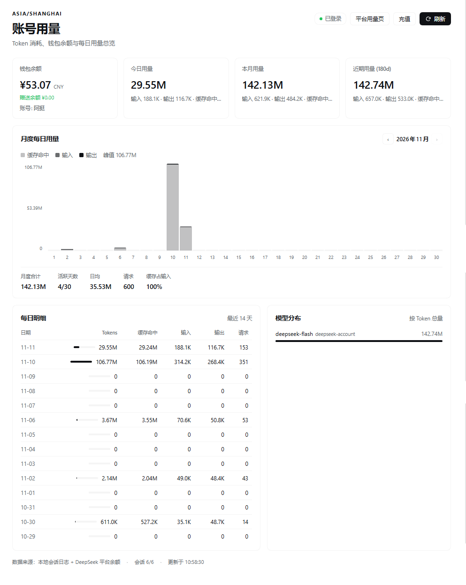

# dsh-token-account

**Token usage, wallet balance, and daily/monthly usage overview for [DeepSeek Harness](https://github.com/deepseek-ai/deepseek-harness) — as a sidebar panel.**

A DSH plugin (Host + Client halves) that adds one entry to the left sidebar and answers
"how much has this account used, and how much is left?" without leaving the app.

> 中文说明见下方 [中文文档](#中文文档)。

## Screenshots

The panel running in the Harness Web UI (light theme), showing the wallet, today / month /
recent totals, the monthly daily-usage chart, the daily table, and the model breakdown:



<sub>Captured on v1.0.0. Since v1.1.0 the input/output and cache/requests detail under each
total sits on its own line instead of being truncated.</sub>

## Features

| Block | Content |
| --- | --- |
| Wallet | DeepSeek Platform wallet balances (recharge + bonus), signed-in profile name, links to the Platform usage page and top-up |
| Today | Tokens used since local midnight: cache reads, cache-miss input, output, request count |
| This month | Tokens used in the current local month, with active days |
| Recent | Tokens over the selected window (180 days by default) |
| Daily usage by month | One stacked bar per day (cache read / input / output), month switcher, monthly total, active days, daily average, peak day, cache share |
| Daily detail | The last 14 days as a table |
| Model breakdown | Tokens per provider/model for the window |

## Install

The plugin is a DSH **bundle**: a package that declares `dsh.bundle.patch`.

```bash
git clone https://github.com/nanvtin-droid/dsh-token-account.git
```

Then install that directory in the current profile (absolute path):

```jsonc
// plugin_manager → install_bundle
{ "target": "C:/path/to/dsh-token-account" }
```

The plugin manager runs the package install, adds `@local/dsh-token-account` to the profile
bundles, and applies the row live. The sidebar entry appears next to the other panel icons;
refresh the Web UI once if the page was already open (client bundles load with the page).

### Uninstall

Remove the `@local/dsh-token-account` bundle from the Plugins page (or `plugin_manager` →
`remove_bundle`). The plugin keeps no state of its own — everything it shows derives from the
session logs and the account service.

## How it works

```
sidebar.panellist#token-account   →  main#token-account
                                        │
                    GET /api/token-account/overview
                                        │
              ┌─────────────────────────┴─────────────────────────┐
   ctx.sessionQuery + ctx.sessionPersistence          ctx.deepseekAccount
   fold assistant/message TokenUsage per day            getBalance / getProfile
```

- **Usage** is folded from the committed session logs — the same `assistant/message` usage
  records the Harness replays. Forked sessions inherit their source's events; only events the
  session actually produced are counted, so a fork never double counts its prefix.
- **Balance** is read by the Host half from `ctx.deepseekAccount.getBalance`, the same Platform
  wallet the account settings show. The browser never receives a credential: the Client half
  only calls the same-origin JSON route.
- Results are cached per session against its persistence revision, so reopening the panel costs
  one `list()` instead of a full log replay. The first visit to a large corpus runs under a
  time budget and the panel keeps asking until every session is folded.

### Token math

The adapter reports `inputTokens` as prompt tokens **not** served from cache, with
`cacheReadTokens` / `cacheWriteTokens` beside it; its own `totalTokens` equals the sum of the
parts (verified against live logs). The panel therefore defines:

```
total = input (cache miss) + output + cache read + cache write
```

and shows cache reads separately, so the numbers never contradict each other.

## Configuration

The row accepts an optional `config` block (no schema is declared, unknown keys are ignored):

```yaml
- id: token-account
  config:
    scanBudgetMs: 7000      # per-request budget for folding new session logs
    maxSessions: 400        # newest sessions considered
    readConcurrency: 3      # parallel session reads
    accountTtlMs: 30000     # wallet cache lifetime
    defaultDays: 120        # day window when `days` is absent
    maxDays: 366            # hard cap for the days query
    clientVersion: '1.0.0'  # x-client-version sent to the Platform
```

## Limits

- Usage is the account activity recorded **on this machine**, in the local time zone. Activity
  from another device only appears on the Platform's own usage page.
- Balance needs a signed-in DeepSeek account; otherwise the panel shows the sign-in hint and
  still reports local token usage.
- Token counts are provider-reported; the plugin does not estimate prices.

## Development

```bash
node test/host.test.mjs     # daily buckets, fork de-duplication, cache reuse, wallet mapping
node test/client.test.mjs   # registrations, locale dictionaries, full render smoke test
```

Both tests run against plain Node (no DSH process needed); the Client test renders the panel
through a stub React runtime.

## License

[MIT](LICENSE)

---

## 中文文档

**DSH 左侧栏账号用量面板：Token 消耗、钱包余额、每日与月度用量总览。**

### 功能

- **钱包余额**：平台真实钱包（充值余额 + 赠送余额）、登录账号名，以及平台用量页 / 充值入口
- **今日 / 本月 / 近 180 天**：总量、缓存命中、输入、输出、请求数
- **月度每日用量**：可切换月份的逐日堆叠柱状图（缓存命中 / 输入 / 输出），附月度合计、活跃天数、日均、峰值、缓存占比
- **每日明细**：最近 14 天表格
- **模型分布**：按 Token 总量排序的模型占比

### 安装

```bash
git clone https://github.com/nanvtin-droid/dsh-token-account.git
```

然后在当前 profile 里用插件管理器安装该目录（绝对路径）：

```jsonc
{ "target": "C:/path/to/dsh-token-account" }
```

装好后左侧栏会多出一个图标；若页面已经打开，刷新一次即可（Client 半部随页面加载）。

### 数据来源与隐私

- 用量来自**本机会话日志**里的 `assistant/message` 用量记录，按本地自然日聚合；分叉会话只统计自身产生的事件，不会重复计算源会话前缀。
- 余额由 **Host 半部**读取 `ctx.deepseekAccount.getBalance`（与设置里的账户同源）。浏览器只请求同源 `GET /api/token-account/overview`，拿不到任何凭据。
- 插件不持久化任何自己的数据；停用即无残留。

### 口径说明

适配器的 `inputTokens` 是**未命中缓存**的输入，另有 `cacheReadTokens` / `cacheWriteTokens`，官方 `totalTokens` 为各项之和。因此面板的「总量」= 输入 + 输出 + 缓存读取 + 缓存写入，缓存命中单独展示，不会出现总量小于缓存命中的怪数。

### 已知边界

- 只统计**本机**产生的用量（本地时区）；其他设备的用量请看平台用量页。
- 未登录 DeepSeek 账号时余额显示登录提示，用量仍可用。
- Token 数为服务商上报值，不做价格估算。

### 配置

同上文 YAML 示例（`scanBudgetMs`、`maxSessions`、`defaultDays` 等）。

### 测试

```bash
node test/host.test.mjs
node test/client.test.mjs
```
